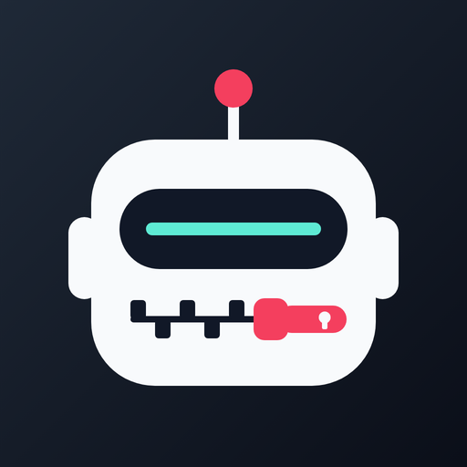

<p align="center">
  
</p>

# 🔐 Token Safety Checker · tightlip 🤐

**Safe claws don't leak.** 🦀 · **Agents talk. Secrets don't.** 🤐

Your agent remembers things. Sometimes it remembers your API keys. 😬
Tokens end up in plain text in `openclaw.json`, in `MEMORY.md`, in daily notes, in `CLAUDE.md`, in session transcripts —
and every one of those gets sent to a model provider again and again.

This skill finds them, tells you exactly which ones to rotate, moves config secrets into env vars,
and installs a guard so new ones never get written. Works for **OpenClaw** 🦀 and **Claude Code** ✳️.

- 🙈 **Secret values never appear in output or CLI args** — only paths, line numbers, detector names and `sha256:` fingerprints
- 🧠 **Scans agent memory** — long-term, short-term, transcripts and logs
- 🛡️ **Prevents new leaks** — Claude Code hook + OpenClaw pre-commit guard
- 🏠 **100% local** — Python standard library, no network calls, no telemetry
- 💾 **Non-destructive** — timestamped private backups, one-command rollback

---

## 📦 Install

| Platform | How |
|---|---|
| 🦀 **OpenClaw** | `clawhub install token-safety-checker` |
| ✳️ **Claude Code** | `/plugin install tightlip --marketplace maoisdamao/token-safety-checker` |
| ✳️ Claude Code (older than v2.1.275) | `claude plugin marketplace add maoisdamao/token-safety-checker` then `claude plugin install tightlip@maoisdamao` |
| 💬 **claude.ai** | Download `tightlip.zip` from the [latest release](https://github.com/maoisdamao/token-safety-checker/releases/latest) → Settings → Capabilities → Skills → Upload |

Requires `python3` (3.10+).

## 💬 Usage

Just ask your agent:

> "Did I leak any API keys into your memory?"
> "Check token safety"
> "Scan my CLAUDE.md and chat history for secrets"
> "Move my tokens to env vars"
> "Stop secrets from being saved to memory"

The agent scans, shows you what it found (never the values), asks before changing anything, and tells you what to rotate. ✨

---

## 🆕 What's new in v3.0

### 🧠 Memory + transcript scan

```
safeclaw memory            # or: safeclaw scan --memory
```

| Scope | 🦀 OpenClaw | ✳️ Claude Code |
|---|---|---|
| 🧠 Long-term | `MEMORY.md`, `USER.md`, `DREAMS.md`, `SOUL.md`, `AGENTS.md`, `memory/imports/` | `CLAUDE.md`, `CLAUDE.local.md`, `.claude/rules/`, auto memory `~/.claude/projects/*/memory/` |
| 📝 Short-term | daily notes `memory/YYYY-MM-DD.md` | prompt history `~/.claude/history.jsonl` |
| 💬 Transcripts | `agents/*/sessions/*.jsonl`, `agents/*/agent/*.sqlite` | `~/.claude/projects/*/*.jsonl`, tool results |
| 📜 Logs | `logs/*.jsonl` | — |

Each unique secret is reported once with its fingerprint, every place it appears, and how to rotate it:

```
🔴 [HIGH] discord-bot-token sha256:93be4b37 ×2 (short_term, log)  ← live: channels.discord.token
    ~/.openclaw/workspace/memory/2026-10-25.md:1
    ~/.openclaw/logs/config-audit.jsonl:2
🔴 [HIGH] openai-api-key sha256:eafdc8e9 ×1 (long_term)
    ~/.openclaw/workspace/MEMORY.md:1
```

🔎 **Live match** = that leaked value is the token your agent is using *right now*. Rotate those first.

> 💡 Found while testing on OpenClaw 2026.6: `openclaw config set channels.discord.token <token>` wrote the full
> command line — token included — to `~/.openclaw/logs/config-audit.jsonl` (no longer the case in 2026.10 — update!),
> and OpenClaw's rotating `openclaw.json.bak*` files keep plaintext tokens after you migrate. v3 catches both,
> so older logs that already hold a token are found too.

### 🛡️ Leak guard

```
safeclaw install-guard
```

- ✳️ **Claude Code** — a `PreToolUse` hook denies any Write/Edit that would put a secret into `CLAUDE.md`, auto memory, `.claude/rules` or other memory files. Claude gets a clear reason and writes a `${PLACEHOLDER}` instead.
- 🦀 **OpenClaw** — a git `pre-commit` hook on your workspace blocks commits that contain secrets.

Remove anytime with `safeclaw uninstall-guard`.

### 🔧 Fixes

Safer `migrate`: list paths, unique env var names, timestamped backups that are never overwritten, exact profile matching,
JSON5 support, preserved formatting, `--secure-profile`. Full list in [CHANGELOG.md](CHANGELOG.md).

---

## 🔍 Commands

| Command | What it does |
|---|---|
| `scan [--deep] [--memory]` | Plaintext secrets in `openclaw.json` (+ git history, + memory) |
| `memory [--platform] [--project] [--no-transcripts]` | Read-only scan of agent memory, transcripts and logs |
| `migrate --findings '…' [--dry-run] [--secure-profile]` | Config secrets → env vars + SecretRef |
| `migrate --restore [--backup FILE]` · `--list-backups` | Roll back |
| `verify [--clean-backup]` | Health check: plaintext left, permissions, env vars, leaky backups |
| `install-guard` · `uninstall-guard` | Leak prevention hooks |

`safeclaw` = `python3 <skill dir>/scripts/safeclaw.py`. Full agent workflow: [SKILL.md](plugins/tightlip/SKILL.md).

## 🔴🟡🟢 Risk levels

| Level | Meaning |
|---|---|
| 🔴 HIGH | Controls the agent or a paid account — channel bot tokens, gateway auth, provider API keys, private keys, live matches |
| 🟡 MEDIUM | JWTs, bearer tokens, URL credentials, Google / Hugging Face keys |
| 🟢 LOW | Other high-entropy `key = value` secrets |

## ⚖️ Security trade-offs

- `migrate` moves secrets **out of `openclaw.json`** into your **shell profile** — better, but still plaintext on disk. Use `--secure-profile`, or prefer `file` / `exec` SecretRefs (password manager) for higher security.
- `memory` is **read-only**. It can't un-send a secret that already reached a model provider — **rotate** what it finds. In-place redaction is planned for v3.1.
- Detection is pattern-based: it can miss custom formats and occasionally flag a false positive. Live-secret matching covers your own config tokens regardless of format.
- The Claude Code guard covers the Write/Edit tools. A secret written through a shell command is not intercepted — the memory scan catches it afterwards.

## 🤝 Contributing

PRs welcome! Run `python3 -m pytest` before sending. The skill lives in [`plugins/tightlip/`](plugins/tightlip/) — workflow spec in [SKILL.md](plugins/tightlip/SKILL.md).

## 📄 License

MIT

---

⭐ If this saves your tokens, a star goes a long way — it helps other agent users find the tool. 🦀🤐

---

# 🔐 Token 安全检查器 · tightlip 🤐

**Safe claws don't leak. 🦀 Agents talk. Secrets don't. 🤐**
**安全的爪子不会泄漏，agent 守口如瓶。**

你的 agent 会记东西——有时候连你的 API Key 也一起记住了。😬
Token 会以明文出现在 `openclaw.json`、`MEMORY.md`、每日笔记、`CLAUDE.md` 和对话记录里——而这些内容会被一次次发送给模型服务商。

这个 skill 会找出它们，告诉你哪些必须轮换，把配置里的密钥迁移到环境变量，并安装防护，阻止新的泄露。支持 **OpenClaw** 🦀 和 **Claude Code** ✳️。

- 🙈 **密钥值永远不会出现在输出或命令行参数中**——只显示路径、行号、类型和 `sha256:` 指纹
- 🧠 **扫描 agent 记忆**——长期记忆、短期记忆、对话记录和日志
- 🛡️ **阻止新的泄露**——Claude Code hook + OpenClaw pre-commit 防护
- 🏠 **100% 本地运行**——仅用 Python 标准库，无网络请求、无遥测
- 💾 **无损操作**——带时间戳的私有备份，一条命令即可回滚

---

## 📦 安装

| 平台 | 方式 |
|---|---|
| 🦀 **OpenClaw** | `clawhub install token-safety-checker` |
| ✳️ **Claude Code** | `/plugin install tightlip --marketplace maoisdamao/token-safety-checker` |
| 💬 **claude.ai** | 从 [最新 Release](https://github.com/maoisdamao/token-safety-checker/releases/latest) 下载 `tightlip.zip` → 设置 → Capabilities → Skills → 上传 |

## 💬 使用方式

直接问你的 agent：

> "我有没有把 API Key 泄露到你的记忆里？"
> "检查一下 token 安全"
> "扫描我的 CLAUDE.md 和聊天记录里的密钥"
> "把我的 token 移到环境变量里"
> "以后别让密钥写进记忆"

---

## 🆕 v3.0 新功能

### 🧠 记忆 + 对话记录扫描

`safeclaw memory`（或 `safeclaw scan --memory`），只读：

| 范围 | 🦀 OpenClaw | ✳️ Claude Code |
|---|---|---|
| 🧠 长期记忆 | `MEMORY.md`、`USER.md`、`DREAMS.md`、`SOUL.md`、`AGENTS.md`、`memory/imports/` | `CLAUDE.md`、`CLAUDE.local.md`、`.claude/rules/`、自动记忆 `~/.claude/projects/*/memory/` |
| 📝 短期记忆 | 每日笔记 `memory/YYYY-MM-DD.md` | 输入历史 `~/.claude/history.jsonl` |
| 💬 对话记录 | `agents/*/sessions/*.jsonl`、`agents/*/agent/*.sqlite` | `~/.claude/projects/*/*.jsonl`、工具输出 |
| 📜 日志 | `logs/*.jsonl` | — |

每个密钥只报告一次：指纹、出现的所有位置、如何轮换。🔎 **live match** 表示泄露的值正是 agent 当前在用的 token——优先轮换。

> 💡 实测发现（OpenClaw 2026.6）：`openclaw config set channels.discord.token <token>` 会把完整命令（包括 token）写进
> `~/.openclaw/logs/config-audit.jsonl`（2026.10 已修复，建议升级）；迁移之后 OpenClaw 自己的 `openclaw.json.bak*` 备份里也仍有明文 token。
> v3 都能查出来，包括旧日志里已经存在的 token。

### 🛡️ 泄露防护

`safeclaw install-guard`：

- ✳️ **Claude Code**——`PreToolUse` hook 拦截把密钥写进 `CLAUDE.md`、自动记忆、`.claude/rules` 等记忆文件的操作，Claude 会改写成 `${占位符}`。
- 🦀 **OpenClaw**——在 workspace 的 git 仓库安装 `pre-commit` hook，阻止提交包含密钥的文件。

随时用 `safeclaw uninstall-guard` 移除。

### 🔧 修复

`migrate` 更安全：支持列表路径、环境变量名不冲突、带时间戳且不会被覆盖的备份、精确匹配 profile、支持 JSON5、保留格式、`--secure-profile`。详见 [CHANGELOG.md](CHANGELOG.md)。

## ⚖️ 安全权衡

- `migrate` 把密钥从 `openclaw.json` 移到 shell profile——更安全，但仍是磁盘上的明文。建议用 `--secure-profile`，或改用 `file` / `exec` 类型的 SecretRef（密码管理器）。
- `memory` 只读。已经发给模型服务商的密钥无法撤回——**请轮换**。原地脱敏（redact）计划在 v3.1 推出。
- 检测基于规则，可能漏掉自定义格式或偶有误报；与当前配置一致的 token 无论格式都能识别。

## 📄 许可证

MIT

---

⭐ 如果这个工具帮你保住了 token，欢迎 Star——让更多 agent 用户发现它。🦀🤐
